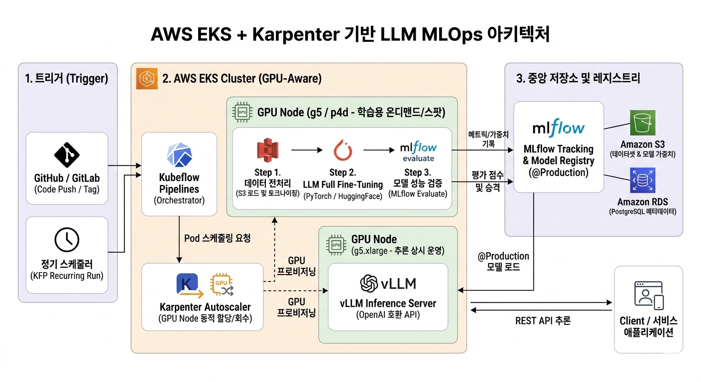

# kf-on-eks (AI Engineering Workshop)

오픈 모델을 파인튜닝하고 평가한 뒤 vLLM으로 서빙하고, 그 위에 RAG 앱을 올려 mlflow 로 추적하는 흐름~~

* [Lab 4. 파이프라인: 데이터 → 학습 → 평가 → 배포 판단 (50분)](https://github.com/gnosia93/kf-on-eks/blob/main/labs/4-pipeline.md)
